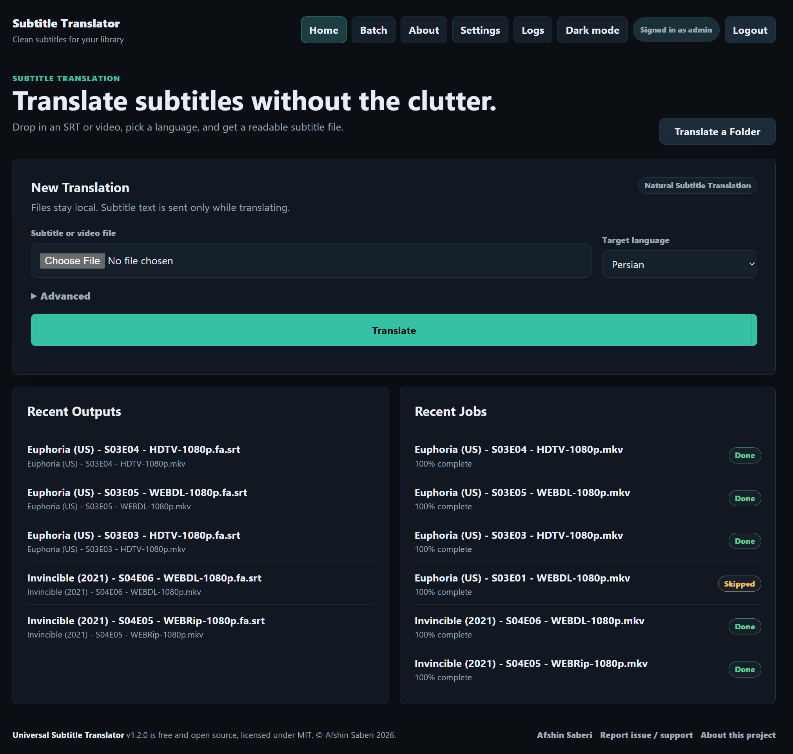
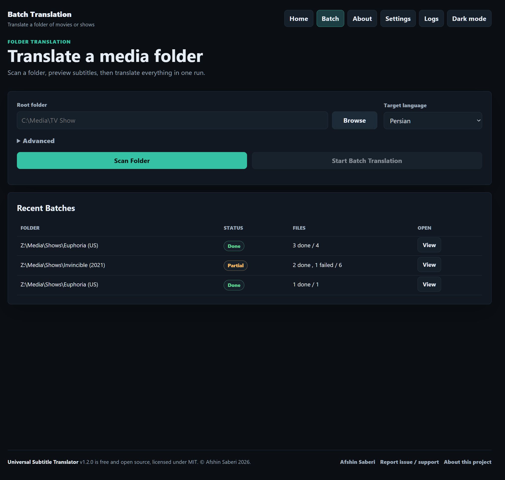

# Universal Subtitle Translator

Translate existing SRT subtitles, or subtitles obtained from videos, through OpenAI and save translated SRT files. FastAPI serves the existing Jinja UI; Nginx fronts it in Docker. SQLite stores jobs, progress and logs.

Current application release: **1.8.2** (previous: 1.8.1). This source update does not imply that container images have been published.

## Capabilities and workflow

- Upload an SRT or a supported video (`.mp4`, `.mkv`, `.avi`, `.mov`, `.m4v`, `.webm`). Browser uploads and downloads use per-job folders in app data.
- Scan a mounted folder recursively, or enter a single video path. Preview the selection, run up to 10 files concurrently, cancel, and download logs or batch reports.
- Skip existing target-language sidecars or extractable embedded target tracks unless overwrite is selected.
- Prefer matching external SRT files, then embedded **text** subtitles. English is first in the built-in language preference, followed by other supported languages and unknown tracks. Within one embedded language, prefer full, non-commentary tracks and then the default track.
- Detect the source language heuristically, batch non-empty cues, translate with the configured OpenAI Chat Completions model, check cue IDs and repair missing or empty translations. Write UTF-8 SRT atomically, preserving dialogue timestamps and supported formatting tags.
- Retain the existing translation credits at the start (when space permits) and end. These add cues and renumber the output; they do not shift dialogue timestamps.
- Support Persian, English, Arabic, Turkish, Spanish, French, German, Italian, Portuguese, Russian, Japanese, Korean and Chinese, with four translation styles.

Mounted writable media keeps the existing naming convention:

```text
/srv/media/Movies/Film.mkv
/srv/media/Movies/Film.en.srt      # existing sidecar or extracted English track
/srv/media/Movies/Film.fa.srt      # translated result, alongside the video
```

A read-only media mount sends results to `OUTPUT_DIR`, preserving relative subfolders; extraction goes to `TEMP_DIR/extracted`. Browser uploads cannot write back to a folder on the browser's computer: their results are downloadable from the job page.

## Fresh Docker Compose installation

Requirements: Docker with Linux container support, **Compose v2.24.0 or newer**, internet access to install dependencies and reach OpenAI, an OpenAI API key with billing/model access, and writable disk space for app data and subtitles. FFmpeg/ffprobe are included in the backend image. No GPU or local AI model is required. amd64 and arm64 builds are configured in CI; see the [verification report](docs/AUDIT-1.8.2.md) for what has actually run.

Linux/macOS shell:

```bash
git clone https://github.com/afshinsb/universal-subtitle-translator.git
cd universal-subtitle-translator
cp .env.example .env
python3 -c 'import secrets; print(secrets.token_urlsafe(48))'
```

Edit `.env` and set these three values before starting:

```dotenv
OPENAI_API_KEY=your-real-key
ADMIN_PASSWORD=a-strong-unique-password
SESSION_SECRET=the-random-value-generated-above
```

Keep the existing `OPENAI_MODEL=gpt-4o-mini`, or select a model compatible with this app's Chat Completions request (`temperature=0.1`). Docker defaults to `DEV_MODE=false`, which refuses default/placeholder auth settings. This is a deliberate security change from 1.8.1. Native development retains its old dev-mode default; set `DEV_MODE=false` for production there too.

On Linux, prepare the bind mount with your media user's UID/GID. Put the same numeric values in `.env` (`PUID`, `PGID`). The backend now runs without root privileges:

```bash
id -u
id -g
mkdir -p data
sudo chown "$(id -u):$(id -g)" data
chmod 700 data
chmod 600 .env
```

For an existing root-owned data directory, first back it up and follow the [upgrade procedure](docs/OPERATIONS.md). Do not recursively change ownership of your media library. Grant the configured user or group write permission only where subtitles should be saved.

To save output next to videos, create `docker-compose.override.yml` with your **existing** host media directory:

```yaml
services:
  backend:
    environment:
      MEDIA_ROOT: /media
    volumes:
      - /srv/media:/media:rw
```

Ensure `/srv/media` exists before starting. Use `:ro` if you want the app-data fallback instead. Only the backend needs the media mount.

```bash
docker compose --env-file .env config -q
docker compose --env-file .env build --pull
docker compose --env-file .env up -d --wait
curl --fail http://localhost:2288/health
docker compose ps
```

Open **http://localhost:2288**, log in as `admin` using your configured password, then open Batch and scan `/media/Movies`. Select a video with English subtitles, start translation, and check for `Film.fa.srt` in the host media directory. Translation sends subtitle text to OpenAI and incurs the provider's normal charges.

The public port binds to `127.0.0.1` by default. Set `APP_BIND_HOST=0.0.0.0` only for intentional network access, with authentication and appropriate HTTPS/firewall setup. Set `SESSION_HTTPS_ONLY=true` when serving the app exclusively over HTTPS. The backend port is internal to Compose.

On Windows PowerShell, use `Copy-Item .env.example .env`, `New-Item -ItemType Directory -Force data`, and `python` instead of `python3`. The Docker commands are the same. Use an absolute Windows source path in the media volume, for example `"D:/Movies:/media:rw"`. Linux `chown`/`chmod` instructions apply to Linux hosts, not Docker Desktop Windows bind mounts.

## Configuration

`.env.example` lists deployment settings. Keep `.env` private; neither it nor app data belongs in an image or Git. Existing environment variable names continue to work.

| Setting | Meaning / default |
| --- | --- |
| `OPENAI_API_KEY` | Required for translation. Read from environment or local `.env`. |
| `OPENAI_MODEL` | `gpt-4o-mini`; must support this app's request format. |
| `ADMIN_USERNAME`, `ADMIN_PASSWORD`, `SESSION_SECRET` | Username defaults to `admin`; configure a unique password and random secret of 32+ characters. |
| `AUTH_ENABLED` | `true`; production configuration requires auth. |
| `DEV_MODE`, `DEMO_MODE` | Docker: `false`; dev/demo modes relax auth setup checks. Static `demo/` never calls the backend. |
| `SESSION_HTTPS_ONLY` | `false` for local HTTP; use `true` behind HTTPS. |
| `APP_PORT`, `APP_BIND_HOST` | Public port `2288`, binding `127.0.0.1`. Internal backend also uses `APP_PORT`. |
| `IMAGE_TAG` | Docker release selection: `1.8.2`. Set explicitly for upgrades/rollbacks. |
| `APP_VERSION` | Native app display override; Docker derives it from `IMAGE_TAG`. Old `.env` overrides no longer mask a newer image. |
| `PUID`, `PGID` | Backend container UID/GID, both `1000`; Linux mounts must allow access. |
| `MEDIA_ROOT` | Optional restriction for backend scans; paths refer to locations **inside** the container. |
| `DATA_DIR` | Native default: repository `data/`; Docker: `/app/data`, bound to `./data`. |
| `UPLOAD_DIR`, `OUTPUT_DIR`, `TEMP_DIR`, `DATABASE_PATH` | Docker: `/app/data/uploads`, `/app/data/outputs`, `/app/data/temp`, `/app/data/app.db`. Keep these persistent. |
| `SRT_BATCH_SIZE`, `SRT_MAX_CHARS` | `40` cues and `12000` characters; also bounded by a script-aware token estimate. |
| `BATCH_FILE_CONCURRENCY` | `10`, valid range 1–10. Reduce it for lower provider rate limits. |
| `FFMPEG_TIMEOUT_SECONDS` | `120` per inspection/extraction command. |
| `OPENAI_TIMEOUT_SECONDS` | `120` per SDK request attempt; retries can extend total elapsed time. |
| `CANCEL_TIMEOUT_SECONDS` | `30`; marks late workers interrupted while waiting for safe checkpoints. |
| `MAX_UPLOAD_MB`, `NGINX_CLIENT_MAX_BODY_SIZE` | `10240` MB and `10G`; mounted media avoids copies and large browser uploads. |
| `OPENAI_INPUT_COST_PER_1M`, `OPENAI_OUTPUT_COST_PER_1M` | Optional cost estimates, `0` by default. Enter your model's current rates. |

The backend starts without an API key and shows setup errors. Startup checks model availability once using the models endpoint; translation requests are separate. `/health` is a liveness check, not proof that the key, model, or media permissions work. `/config/status` provides authenticated configuration readiness.

## Updates, rollback and published images

See [OPERATIONS.md](docs/OPERATIONS.md) for exact backup, source-build upgrade, published-image upgrade, rollback and offline smoke-test commands.

For an existing source-built installation, preserve `.env`, data and all volume overrides. Complete the new auth/UID setup before updating, then select `IMAGE_TAG=1.8.2`, build and recreate the services during your maintenance window. No database schema migration is introduced by this patch. Never delete the data directory or replace `.env` with the example during an update.

`docker-compose.hub.yml` is a pull-only alternative and requires `DOCKERHUB_NAMESPACE` and a version that the owner has actually published. The namespace was a placeholder in 1.8.1; this audit has not published images or verified an application image registry. Do not assume `1.8.2` exists on Docker Hub. This repository had no image-publishing workflow or configured publishing credentials to reuse, so CI builds and tests without publishing. Maintainer publishing instructions are in the operations guide.

## Troubleshooting and limitations

- **503 authentication setup incomplete:** configure `ADMIN_PASSWORD` and `SESSION_SECRET`, keep `AUTH_ENABLED=true`, then recreate the backend. Default credentials are refused in Docker production mode, including forged cookies signed with the old default secret.
- **Permission denied / backend unhealthy:** check ownership of `./data` and `PUID:PGID`. Inspect `docker compose logs --tail=100 backend`. Do not share credentials in diagnostic output. Use `config -q` to validate Compose; plain `docker compose config` can display secrets.
- **No subtitle found:** bitmap subtitles (PGS, DVD/VobSub) and videos with no subtitles are unsupported. There is neither OCR nor transcription. Add a matching English SRT, or use an embedded text track (`subrip`, `ass`, `ssa`, `webvtt`, `mov_text`).
- **Wrong folder or missing output:** enter container paths such as `/media/Movies`. A read-only mount uses `OUTPUT_DIR`; a writable mount saves next to the video. Browser-upload results are under `data/outputs/<job-id>/` and downloadable from the job page.
- **Malformed SRT:** malformed blocks now fail explicitly instead of silently dropping dialogue. UTF-8/BOM, BOM-marked UTF-16/UTF-32 and legacy CP1256/CP1252/Latin-1 decoding are supported. Legacy encodings are ambiguous; convert to UTF-8 if characters look wrong.
- **Rate limits or timeouts:** reduce concurrency or batch size, check model/quota access and adjust timeouts. The OpenAI SDK retries transient failures twice; alignment and Persian-script validation can make additional requests. Cancellation stops at safe checkpoints and cannot revoke a request already accepted by the provider.
- **After restart:** finished subtitles persist. Unfinished jobs are marked `interrupted`; there is no checkpoint/resume of partially translated files. Re-run the batch to skip completed files. Only completed output is published; a hard kill can leave hidden temporary files that can be removed when no work is active.
- **Atomic writes:** overwrite-disabled publication requires hard-link support in the destination filesystem (normal local Linux filesystems and NTFS support it). An unsupported network/filesystem operation fails without replacing an existing subtitle. Enable overwrite only if replacement is intended.
- **Multiple servers:** worker/cancellation/output coordination is in one backend process. Run one backend replica and one Uvicorn worker. Separate processes can still spend duplicate provider calls; atomic no-overwrite protects the completed output.
- **Resources:** CPU-only FFmpeg subtitle extraction does not transcode the video. Media stays on its mount in batch mode. SRTs and batches are held in memory; large uploads consume disk. There is no measured minimum RAM/CPU guarantee.
- **Cleanup:** Settings cleanup deletes app-managed uploads, fallback outputs, temporary files and history. It leaves external media subtitles alone. Download/back up wanted outputs before cleanup.

## Development and verification

Python 3.10+ is supported; the Docker runtime uses Python 3.12. From the repository root:

```bash
python -m venv .venv
# Linux/macOS: source .venv/bin/activate
# PowerShell: .\.venv\Scripts\Activate.ps1
python -m pip install --require-hashes -r backend/requirements-dev.txt
python -m ruff check backend scripts
python -m compileall -q backend/app scripts
python -m pytest -q
python scripts/smoke.py
python -m pip_audit --disable-pip --no-deps -r backend/requirements.txt
```

Install FFmpeg/ffprobe on PATH for native media tests. Tests isolate credentials and data. The standalone smoke generates a tiny video with two English tracks, extracts the full track, exercises the real OpenAI SDK using an in-memory HTTP fixture, translates to UTF-8 SRT, verifies exact timestamps/formatting/naming/location, then confirms a repeat skips and preserves the result. It makes no external model calls. Container smoke commands are in the operations guide.

To run natively after configuring local directory paths in `.env`:

```bash
cd backend
python -m app
```

To update dependency locks, edit the `.in` files and use `uv==0.13.1`:

```bash
uv pip compile --universal --python-version 3.10 --generate-hashes --output-file backend/requirements.txt backend/requirements.in
uv pip compile --universal --python-version 3.10 --generate-hashes --constraint backend/requirements.txt --output-file backend/requirements-dev.txt backend/requirements-dev.in
```

Runtime dependencies and hashes are frozen; Python/Nginx manifest digests are pinned. Debian FFmpeg and OS security packages come from the live Bookworm repositories, so complete OS-layer bit-for-bit reproducibility is not claimed. Refresh image digests and locks deliberately, then repeat verification.

## Screenshots and static demo

| Home | Batch |
| --- | --- |
|  |  |

The existing `demo/` is a separate simulated preview with no uploads, database, provider calls or secrets. For Cloudflare Pages use framework `None`, build command `exit 0`, output directory `demo`, and no environment variables. It does not perform real translation.

## Privacy and license

Subtitle text is sent to the configured OpenAI service; videos are processed locally. Job history and logs persist in app data. This project is [MIT licensed](LICENSE). © 2026 Afshin Saberi.
